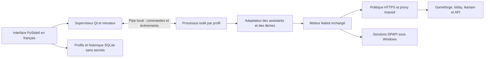

# Architecture Ikabot Desktop

Le moteur Ikabot 7.7.2 reste inchangé dans `ikabot/`. Le nouveau code se trouve dans `desktop/`. Le dépôt original est conservé dans `/workspace/ikabot` ; la copie de développement est `/workspace/ikabot-desktop`, branche `desktop/francais`.

## Responsabilités

| Composant | Responsabilité |
|---|---|
| `desktop_app.py` | Démarrage, verrou de l'instance locale, traduction Qt, compatibilité multiprocessing gelé |
| `ui.py` | Fenêtre, navigation, profils, thèmes, tableaux, assistants, notification système |
| `catalog.py` | Liste explicite et auditée des commandes et de leur disponibilité |
| `supervisor.py` | Démarrage des processus, IPC non bloquant, prévention des doublons, arrêt de l'arbre possédé |
| `engine.py` | Connexion existante, formulaires au lieu de stdin, projection des villes/mouvements, invocation du moteur |
| `network.py` | Délais bornés, TLS obligatoire, proxy appliqué à requests et garde des sockets du processus |
| `security.py` | DPAPI, écriture atomique des secrets ; aucun repli en clair hors Windows |
| `storage.py` | SQLite : métadonnées des profils, préférences et événements structurés |
| `notifications.py` | Validation des configurations compatibles Telegram/Discord, sans envoi implicite |
| `i18n.py` | Traductions d'invites courantes ; catalogue encore partiel |

## Réutilisation des fonctions

Le moteur expose des `@configurator` qui lisent les choix de l'utilisateur et retournent les paramètres d'une `@task`. Desktop appelle le configurateur original, remplace seulement ses points d'entrée/sortie, puis appelle la tâche originale. Le superviseur remplace la création de processus CLI et possède la durée de vie de la session. Les validations de `pedirInfo.read` restent exécutées. Le formulaire Qt reçoit leurs contraintes et valide également les choix.

Le contrat des entrées raccordées est vérifié par les tests, pas supposé. Une opération est autorisée à la fois par profil. Les autres profils et la fenêtre restent utilisables. Cette version n'est pas un ordonnanceur de plusieurs tâches simultanées d'un même compte.

Les données du tableau de bord sont des projections des résultats des analyseurs Ikabot, sans en-têtes HTTP ni cookies. Les mouvements utilisent le même endpoint et le même chemin JSON que `shipMovements.py`. Aucune donnée fictive n'est injectée en production. Les fixtures sont limitées aux tests. Un échec de lecture des mouvements est visible même si les villes sont disponibles.

## Isolation et secrets

Chaque profil a son répertoire de session. Desktop ne lit pas les fichiers de la CLI historique. Windows chiffre les données de session complètes (cookies et réglages de bots inclus) avec DPAPI pour l'utilisateur courant, avant toute écriture. Les mots de passe de connexion restent en mémoire ; le moteur peut réutiliser les cookies protégés. Sous Linux, les données sensibles restent dans une mémoire privée au processus, jamais dans SQLite.

Les réponses passent par un Pipe hérité du processus parent, sans argument de commande ni fichier intermédiaire. Le protocole repose sur multiprocessing et ne doit jamais être exposé à des clients non fiables. Le fichier de journal brut du moteur est initialisé sur le périphérique nul, puis remplacé par un gestionnaire qui transmet seulement le niveau et le composant : les avertissements et erreurs restent visibles sans leurs en-têtes ou corps sensibles. SQLite conserve uniquement des événements contrôlés et des classes d'erreur. Les sorties éphémères visibles ont une occultation de secrets connus et de motifs sensibles ; celle-ci ne constitue pas une preuve exhaustive contre toutes les sorties possibles d'une future version du moteur.

## Réseau

L'adaptateur est chargé avant les requêtes d'authentification. La politique s'applique à `requests.Session.request` et `send`, y compris aux appels libres de requests et aux redirections. Elle interdit HTTP, force la vérification TLS et borne les délais à 60 secondes par phase. Elle conserve les variables de confiance CA de l'environnement. Sans proxy choisi, le proxy de la plateforme et sa configuration restent actifs.

En mode proxy, le proxy choisi est imposé même si le moteur fournit une autre configuration. Aucun repli direct n'est programmé. Les méthodes socket `connect`, `connect_ex` et `sendto` sont restreintes à l'adresse et au port du proxy. La découverte d'API par DNS UDP/subprocess est remplacée par DNS-over-HTTPS, à travers cette même politique. SOCKS doit utiliser `socks5h` pour résoudre la destination côté proxy. Le nom du proxy est résolu initialement par le système.

Ce contrôle Python n'est pas un pare-feu : il n'isole pas les autres applications, ne couvre pas du code natif arbitraire, et n'est pas présenté comme infaillible. Les extensions arbitraires et le serveur web du moteur restent exclus. Les tests de panne couvrent HTTP CONNECT local sous Linux ; les proxies HTTPS/SOCKS, IPv6, Windows, VPN et une vraie authentification restent à vérifier.

## Fermeture et reprise

Fermer la fenêtre la masque si la zone de notification est disponible. Quitter envoie une demande de fermeture aux processus disponibles, puis termine les processus encore occupés et leurs descendants. Un arrêt forcé ne peut pas annuler une commande déjà reçue par le serveur. Les seuls PID concernés sont ceux des processus créés et possédés par le superviseur.

Les tâches ne sont pas automatiquement restaurées. L'historique permet d'identifier les opérations précédentes ; il faut vérifier le jeu avant de les relancer. Il n'existe pas d'export de cookies en clair ni de mise à jour du moteur par pip à l'intérieur de l'application.
